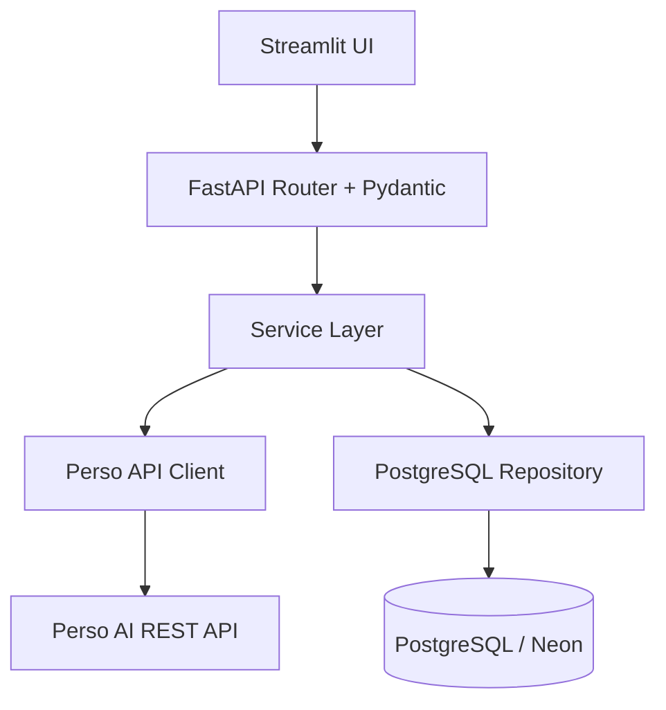

# Day60 — Perso API 통합 웹서비스 구현

## 아키텍처



### 주요 파일

- `frontend/app.py`: UI, 업로드·생성·진행률·결과 화면
- `frontend/api_client.py`: FastAPI 전용 요청 클라이언트
- `backend/main.py`: FastAPI 실행 진입점
- `backend/routers/perso_router.py`: HTTP 엔드포인트
- `backend/schemas/jobs.py`: 요청 검증 및 비용 확인 필드
- `backend/services/job_service.py`: 처리 순서/규칙
- `backend/integrations/perso_client.py`: Perso API HTTP 요청, 업로드 SAS 처리
- `backend/repositories/job_repository.py`: SQL 접근
- `backend/database/schema.sql`: DB 생성 쿼리
- `tests/`: 실 API를 사용하지 않는 테스트


## 실행 (터미널 2개)

터미널 A:

```powershell
uvicorn backend.main:app --reload --port 8000
```

터미널 B (같은 프로젝트 폴더에서):

```powershell
streamlit run frontend/app.py
```


## 통합 실습 단계

1. Space 목록을 조회해 사용할 Space ID를 확인합니다.
2. 미디어 업로드(오디오 wav/mp3 또는 영상 mp4/mov/webm)를 실행합니다.
3. 업로드 응답 `mediaSeq`가 `media_assets`에 기록되었는지 확인합니다.
4. STT / Audio Separation / Dubbing 중 하나를 선택합니다.
5. 비용 동의 체크박스를 누른 뒤 생성 요청합니다.
6. 반환된 `projectSeqList`가 `perso_jobs`에 저장되었는지 확인합니다.
7. **5초 간격 자동 조회 토글**을 활성화하거나 1회 조회 버튼으로 진행률을 갱신합니다.
8. Completed 상태가 되면 스크립트·파일 목록·다운로드 URL을 조회합니다.
9. 완료된 영상 더빙에서만 Lip Sync 생성 기능을 테스트합니다.
10. API/DB 오류와 정상 흐름을 확인하고 프로젝트를 설명합니다.

## FastAPI 엔드포인트

| 메서드 | URL | 동작 |
|---|---|---|
| GET | `/api/health` | 서비스 상태 |
| GET | `/api/spaces` | Perso Space 목록 |
| GET | `/api/languages` | 지원 언어 목록 |
| POST | `/api/media/upload` | SAS 업로드 후 DB 저장 |
| POST | `/api/jobs` | STT / 분리 / 더빙 생성 |
| POST | `/api/jobs/lip-sync` | 완료된 더빙의 립싱크 |
| GET | `/api/jobs` | PostgreSQL 작업 목록 |
| GET | `/api/jobs/{space_seq}/{project_seq}` | 작업 상세 |
| GET | `/api/jobs/{space_seq}/{project_seq}/progress` | 상태 1회 조회 및 DB 갱신 (GET 백오프 적용) |
| GET | `/api/jobs/{space_seq}/{project_seq}/script` | 작업 스크립트 |
| GET | `/api/jobs/{space_seq}/{project_seq}/files` | 산출물 목록 |
| GET | `/api/jobs/{space_seq}/{project_seq}/download?target=all` | 다운로드 URL |
